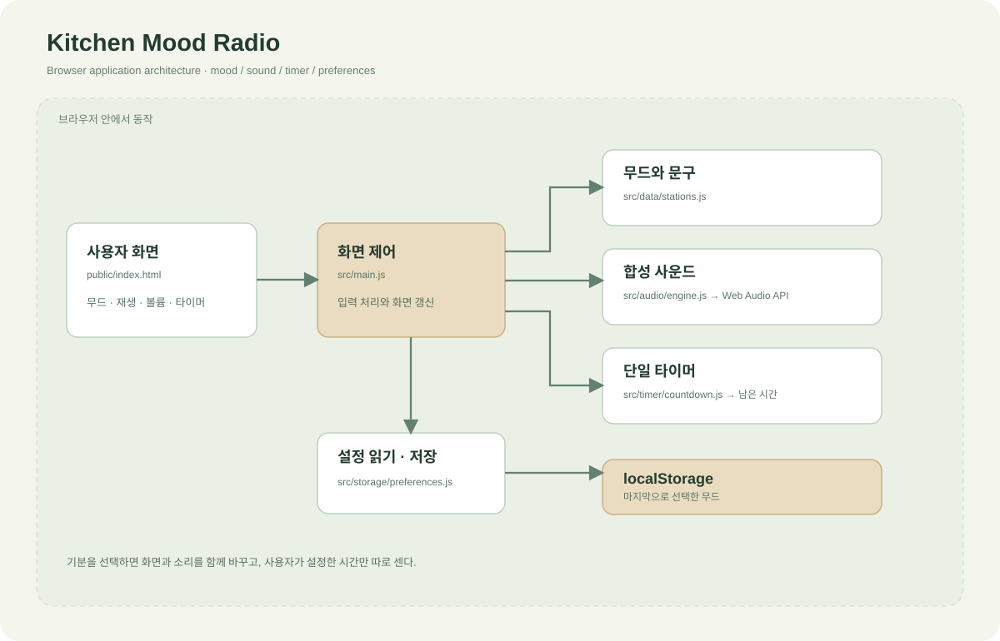
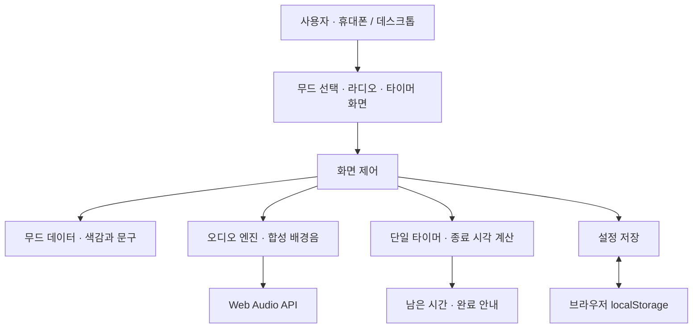

# LG AX 해커톤 · 국립창원대학교

## Theme B | Kitchen Mood Radio

**기분에 따라 주방의 소리와 색감을 바꾸는 웹앱.**

계란 프라이 한 장에도 분위기는 필요하니까. 오늘의 기분을 고르면 작은 주방이 나만의 라디오 공간으로 바뀝니다.


*기분별 배경음과 조리 타이머를 주방에서 사용하는 장면의 콘셉트 스케치.*

| 항목 | 내용 |
| --- | --- |
| 공모전 주제 | Theme B — 새로운 키친 경험과 AI 기반 제품·서비스 설계 |
| 프로젝트 | 키친 무드 라디오 |
| 서비스 형태 | 모바일·데스크톱 웹앱 |
| 개발 단계 | v0.1 · 화면과 핵심 기능 구현 |

## 주제의 흐름

혼자 요리하는 시간에 기분에 맞는 배경음, 색감, 짧은 한마디를 더합니다. 주방을 기능적인 공간에서 잠깐 쉬어가는 생활 공간으로 바꾸는 감성 서비스입니다.

1. **기분 선택** — 차분하게, 신나게, 집중해서 중 오늘의 무드를 고릅니다.
2. **라디오 재생** — 합성 배경음을 켜고 볼륨을 조절합니다.
3. **조리 시간 설정** — 필요한 시간을 직접 정하고 타이머를 시작합니다.
4. **작은 휴식** — 기다리는 동안 오늘의 한마디를 바꿔 봅니다.
5. **완료 확인** — 타이머가 끝나면 요리 상태를 확인합니다.

## 구조도





## 지금 구현된 것

- 세 가지 무드와 화면 색감 전환
- 기분별 합성 화음과 간단한 리듬, 재생·정지·볼륨 제어
- 3·5·10분 프리셋, 1~60분 직접 설정, 일시정지·재개·초기화
- 무드별 7개 문구와 한마디 전환
- 마지막으로 선택한 무드 저장
- 휴대폰·데스크톱 반응형 화면
- 화면, 사운드, 타이머, 설정 저장 모듈 분리

배경음은 브라우저에서 직접 합성합니다. 소리는 사용자가 재생을 눌렀을 때 시작됩니다. 페이지를 새로 열면 타이머와 재생 상태는 초기화됩니다.

## 실행

Node.js 20 이상으로 정적 파일을 빌드합니다. 외부 패키지 설치는 필요하지 않습니다.

```bash
git clone https://github.com/jeongiryang/lg-ax-hackathon-cwnu-2026.git
cd lg-ax-hackathon-cwnu-2026
npm run build
python -m http.server 8769 --directory dist
```

브라우저에서 `http://localhost:8769`를 엽니다. Python 대신 다른 정적 웹서버를 사용해도 됩니다.

## 폴더 구성

```text
.
├── README.md
├── package.json
├── public/
│   └── index.html
├── src/
│   ├── main.js
│   ├── audio/
│   │   └── engine.js
│   ├── timer/
│   │   └── countdown.js
│   ├── data/
│   │   └── stations.js
│   ├── storage/
│   │   └── preferences.js
│   └── styles/
│       └── main.css
├── scripts/
│   └── build.mjs
├── dist/
│   ├── index.html
│   ├── app/
│   └── assets/
└── docs/
    ├── concept.md
    ├── architecture.md
    ├── user-flow.md
    ├── audio-design.md
    ├── timer-behavior.md
    ├── roadmap.md
    └── images/
        ├── kitchen-mood-concept.png
        └── architecture.svg
```

## 문서

- [서비스 기획](docs/concept.md)
- [모듈 구조와 빌드 흐름](docs/architecture.md)
- [화면과 사용 흐름](docs/user-flow.md)
- [무드 라디오 동작](docs/audio-design.md)
- [타이머 상태와 시간 계산](docs/timer-behavior.md)
- [다음 개발 작업](docs/roadmap.md)

## 기술

HTML · CSS · JavaScript ES Modules · Web Audio API · localStorage

개인 웹 프로토타입이며, LG전자나 국립창원대학교의 공식 서비스는 아닙니다.
