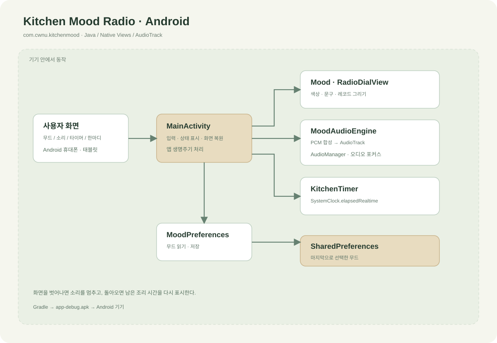
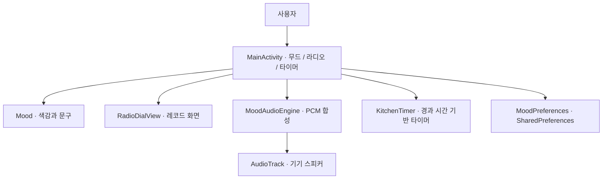

# LG AX 해커톤 · 국립창원대학교

## Theme B | Kitchen Mood Radio

**기분에 따라 주방의 소리와 색감을 바꾸는 Android 앱.**

계란 프라이 한 장에도 분위기는 필요하니까. 오늘의 기분을 고르면 작은 주방이 나만의 라디오 공간으로 바뀝니다.


*무드 라디오와 조리 타이머를 사용하는 장면의 콘셉트 스케치.*

| 항목 | 내용 |
| --- | --- |
| 공모전 주제 | Theme B — 새로운 키친 경험과 AI 기반 제품·서비스 설계 |
| 앱 | Kitchen Mood Radio · 키친 무드 라디오 |
| 패키지 | `com.cwnu.kitchenmood` |
| 구현 | Java · Android 네이티브 View · AudioTrack |
| 최소 버전 | Android 8.0 · API 26 |
| 앱 버전 | 0.2.0 |

## 사용 흐름

1. 오늘의 기분을 차분하게, 신나게, 집중해서 중에서 고릅니다.
2. 라디오를 켜고 볼륨을 조절합니다.
3. 필요한 조리 시간을 직접 정합니다.
4. 기다리는 동안 오늘의 한 문장을 바꿔 봅니다.
5. 타이머가 끝나면 화면에서 완료를 확인합니다.

## 구조도





## 지금 구현된 것

- 세 가지 무드와 화면 색감 전환
- 기분별 합성 배경음, 재생·정지·볼륨 제어
- 3·5·10분 프리셋과 1~60분 직접 입력
- 타이머 시작·일시정지·재개·초기화
- 무드별 7개 문구와 한 문장 교체
- 마지막 무드 저장과 화면 회전 상태 복원
- 화면을 벗어날 때 소리 정지
- 경과 시간 시계를 사용하는 타이머와 복귀 시 화면 갱신

앱은 기기 안에서 음을 직접 합성합니다. 추가 권한이나 계정 설정 없이 실행할 수 있습니다. 앱 프로세스가 종료된 뒤의 알림과 백그라운드 음악은 현재 지원하지 않습니다.

## Android Studio 실행

1. 저장소 루트 폴더를 Android Studio에서 엽니다.
2. Gradle JDK 17, Android SDK Platform 36, Build Tools 35.0.0을 준비합니다.
3. Gradle 동기화를 마친 뒤 `app`을 Android 기기나 에뮬레이터에서 실행합니다.

Windows 명령줄:

```powershell
.\gradlew.bat assembleDebug testDebugUnitTest lintDebug
```

macOS / Linux:

```bash
./gradlew assembleDebug testDebugUnitTest lintDebug
```

APK는 `app/build/outputs/apk/debug/app-debug.apk`에 생성됩니다.

## 폴더 구성

```text
.
├── app/
│   ├── build.gradle
│   └── src/
│       ├── main/
│       │   ├── AndroidManifest.xml
│       │   ├── java/com/cwnu/kitchenmood/
│       │   │   ├── MainActivity.java
│       │   │   ├── audio/MoodAudioEngine.java
│       │   │   ├── model/Mood.java
│       │   │   ├── storage/MoodPreferences.java
│       │   │   ├── timer/KitchenTimer.java
│       │   │   └── ui/RadioDialView.java
│       │   └── res/
│       └── test/java/com/cwnu/kitchenmood/
├── gradle/wrapper/
├── gradlew
├── gradlew.bat
├── build.gradle
├── settings.gradle
├── gradle.properties
├── docs/
│   ├── android-development.md
│   ├── architecture.md
│   ├── audio-design.md
│   ├── timer-behavior.md
│   ├── user-flow.md
│   └── images/
└── web/
    ├── package.json
    ├── src/
    ├── public/
    ├── scripts/
    └── dist/
```

## 개발 문서

- [Android 개발과 실행](docs/android-development.md)
- [앱 구조](docs/architecture.md)
- [서비스 기획](docs/concept.md)
- [화면과 사용 흐름](docs/user-flow.md)
- [배경음 설계](docs/audio-design.md)
- [타이머 동작](docs/timer-behavior.md)
- [다음 개발 작업](docs/roadmap.md)
- [웹 미리보기 구조](docs/web-architecture.md)

개인 앱 프로토타입이며, LG전자나 국립창원대학교의 공식 서비스는 아닙니다.
