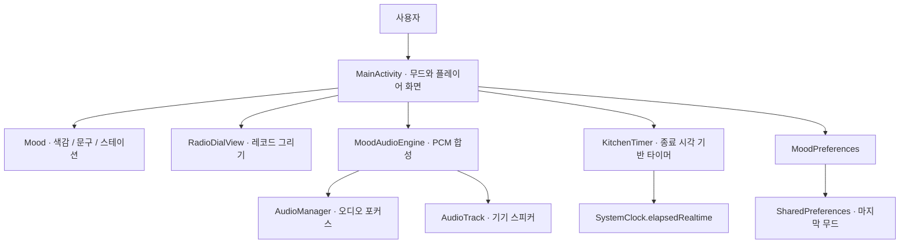
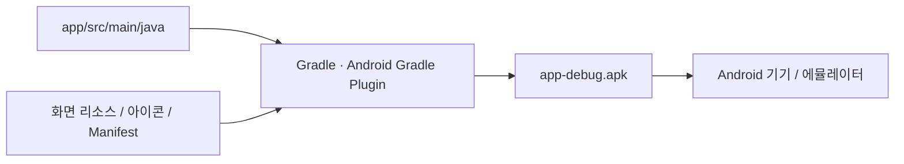

# Android 앱 구조

## 패키지 역할

| 패키지 / 클래스 | 역할 |
| --- | --- |
| `com.cwnu.kitchenmood.MainActivity` | 화면 생성, 사용자 입력, 생명주기 처리 |
| `model.Mood` | 세 가지 무드, 색상, 스테이션 이름, 문구 |
| `ui.RadioDialView` | 원형 레코드 표시와 재생 중 움직임 |
| `audio.MoodAudioEngine` | 낮은 볼륨의 PCM 음 생성과 재생 제어 |
| `timer.KitchenTimer` | 시작, 일시정지, 재개, 초기화, 완료 |
| `storage.MoodPreferences` | 마지막 선택 무드를 앱 설정에 저장 |

## 화면과 생명주기

화면을 벗어나면 오디오를 정지한다. 돌아오면 타이머의 종료 시각을 기준으로 화면을 갱신한다. 화면 회전으로 Activity가 다시 만들어질 때는 무드, 문구 위치, 남은 시간과 타이머 상태를 복원한다.

## 오디오

사용자가 재생 버튼을 누르면 오디오 포커스를 요청하고 합성 음 생성 스레드를 시작한다. 다른 앱이 오디오를 사용할 때는 재생을 멈춘다. 앱 화면과 오디오 스레드는 각각 화면 처리와 음 생성만 담당한다.

## 시간

타이머는 경과 시간 시계를 사용한다. 현재 시각에서 종료 시각까지의 차이가 남은 시간이다. 시스템의 날짜·시간 설정을 바꿔도 조리 시간 계산에 영향을 주지 않는다.

## 빌드 결과

[웹 미리보기 구조](web-architecture.md)는 별도로 정리한다.
