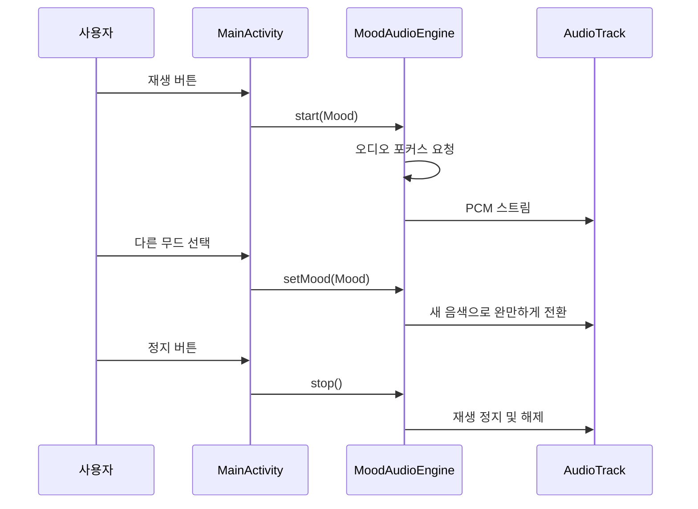

# 무드 라디오 동작

## 세 가지 스테이션

| 무드 | 음색 | 진행 | 화면 |
| --- | --- | --- | --- |
| 차분하게 | 부드러운 화음 | 느린 화음 변화 | 녹색과 베이지 |
| 신나게 | 화음과 낮은 리듬음 | 일정한 박자 | 오렌지와 갈색 |
| 집중해서 | 맑은 화음과 짧은 음 | 일정한 악센트 | 푸른색과 회색 |

## Android

MoodAudioEngine이 44.1kHz, 16-bit, mono PCM을 생성하고 AudioTrack에 전달한다. 음 생성은 전용 스레드가 처리한다. 무드 전환과 볼륨 변경은 짧은 구간 동안 완만하게 적용한다.

사용자가 재생을 누르면 오디오 포커스를 요청하고 음을 생성한다. 포커스를 잃거나 Activity가 화면을 벗어나면 재생을 멈춘다. 종료 시에는 스레드와 AudioTrack 자원을 해제한다.

## 웹 미리보기

web/src/audio/engine.js는 Web Audio API로 같은 콘셉트의 배경음을 만든다. Android 앱의 오디오와 구현은 별개다.

라디오라는 이름은 스테이션의 분위기를 나타내며 실제 방송을 수신하지 않는다.
