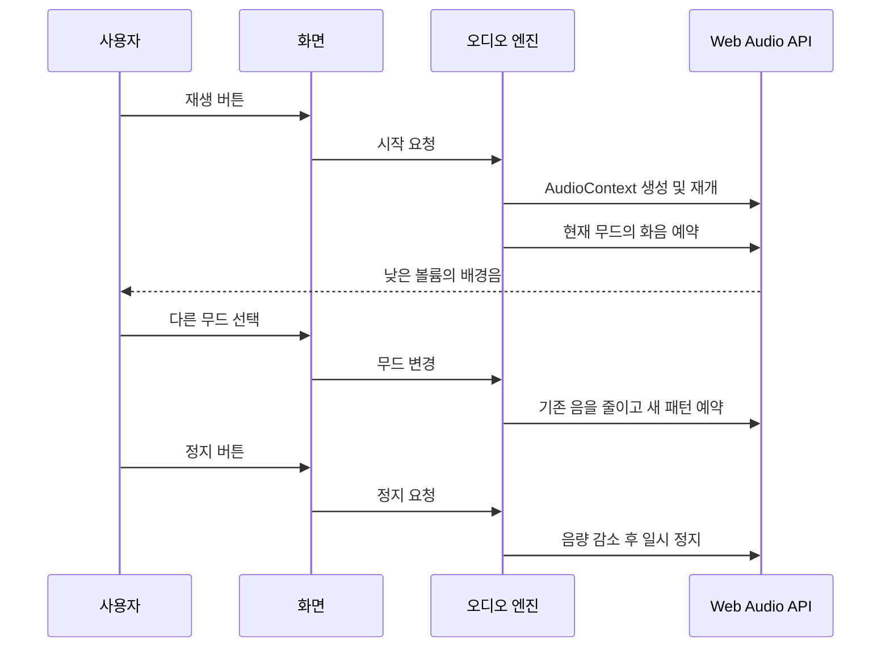

# 무드 라디오 동작

## 세 가지 스테이션

| 무드 | 음색 | 진행 | 화면 |
| --- | --- | --- | --- |
| 차분하게 | 부드러운 사인파 화음 | 느린 화음 변화 | 녹색과 따뜻한 베이지 |
| 신나게 | 삼각파 화음과 낮은 리듬음 | 짧은 화음과 일정한 박자 | 오렌지와 짙은 갈색 |
| 집중해서 | 맑은 화음과 높은 짧은 음 | 일정한 간격의 악센트 | 푸른색과 회색 |

음원 파일 대신 브라우저의 오실레이터로 음을 만든다. 각 음에는 시작과 끝에 부드러운 볼륨 변화를 적용해 갑작스러운 클릭 소리를 줄인다.

## 재생 흐름

## 제어

- 페이지를 열기만 해서는 소리가 시작되지 않는다.
- 사용자가 재생을 눌렀을 때 오디오를 준비한다.
- 볼륨은 0~100% 범위로 조절한다.
- 소리를 멈추면 예약 반복을 중단하고 기존 음을 부드럽게 줄인다.
- 소리 재생을 지원하지 않는 브라우저에서는 안내를 표시한다.

라디오라는 이름은 스테이션 분위기를 나타낸다. 실제 라디오 방송을 수신하지 않는다.
