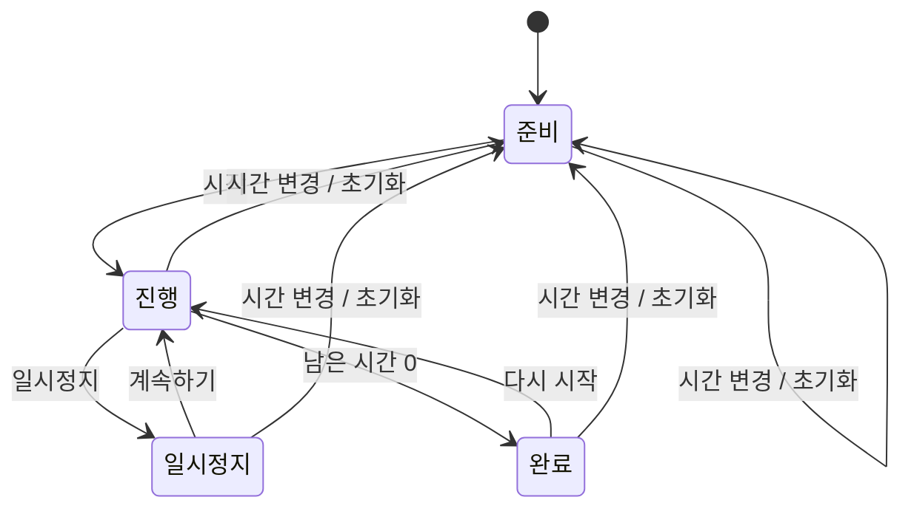

# 조리 타이머 동작

## 입력

3분, 5분, 10분 버튼을 누르거나 1~60분을 직접 입력한다. 시간 선택은 현재 타이머를 초기화한다. 타이머는 사용자가 정한 한 구간만 센다.

## 상태

## 시간 계산

시작할 때 `종료 시각 = 현재 시각 + 남은 시간`으로 계산한다. 화면을 갱신할 때는 종료 시각에서 현재 시각을 뺀다. 단순히 표시 숫자를 하나씩 줄이는 방식보다 화면이 잠시 비활성화된 경우를 처리하기 쉽다.

일시정지하면 현재 남은 시간을 보관한다. 계속하기를 누르면 그 시간으로 새로운 종료 시각을 계산한다.

## 완료 안내

남은 시간이 0이 되면 `00:00`과 완료 안내를 표시한다. 라디오가 재생 중이면 짧은 합성 알림음을 함께 낸다. 소리를 켜지 않은 상태에서는 화면으로만 안내한다.

페이지를 새로 열면 타이머도 초기화된다. 앱을 닫은 뒤의 알림은 현재 지원하지 않는다.
