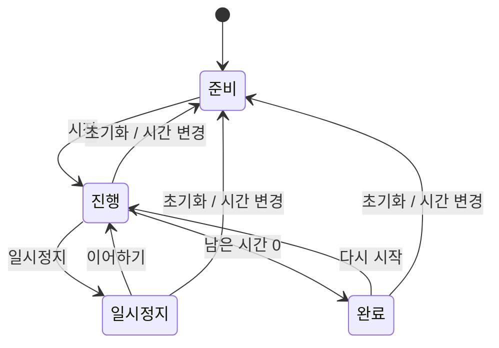

# 조리 타이머 동작

## 입력과 상태

3분, 5분, 10분 버튼을 누르거나 1~60분을 직접 입력한다. 시간을 바꾸면 현재 타이머를 초기화한다. 타이머는 사용자가 정한 한 구간만 센다.

## Android의 시간 계산

KitchenTimer는 LongSupplier로 경과 시간 시계를 받는다. 앱에서는 SystemClock.elapsedRealtime을 연결한다. 날짜·시간 설정 변경과 관계없이 종료 시각과 현재 경과 시간의 차이로 남은 시간을 계산한다.

일시정지하면 현재 남은 시간을 보관한다. 이어하기를 누르면 그 시간으로 새로운 종료 시각을 만든다. 화면 회전 시에는 상태와 종료 시각을 복원한다.

## 완료

남은 시간이 0이 되면 완료 상태와 안내를 표시한다. 현재 재생 중인 배경음은 멈춘다. 완료 신호는 한 번만 전달한다.

앱을 다시 열어도 계속되는 백그라운드 알림은 현재 지원하지 않는다.

## 단위 검사

늦어진 화면 갱신, 일시정지 중 경과 시간, 화면 복원 후 종료 시각 유지, 시간 변경, 만료 시 완료 신호 1회를 확인한다.
