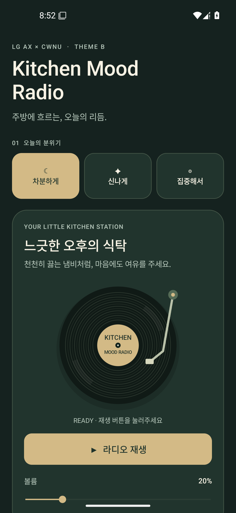
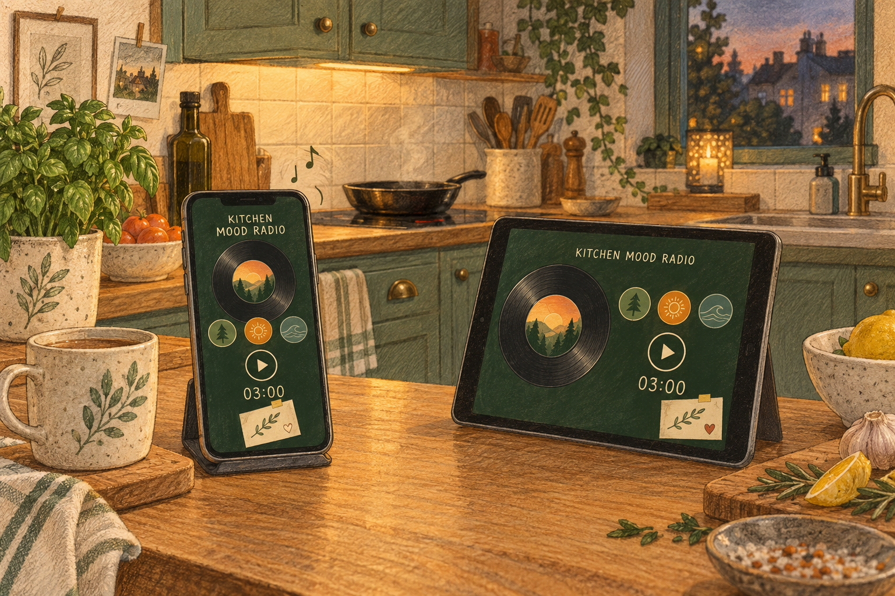

# 화면과 사용 흐름

## Android v0.2 화면

Android 앱은 기분 선택, 라디오, 타이머, 문장 카드를 세로 스크롤 화면에 배치한다. 첫 화면에서 기분과 라디오를 고르고, 아래로 내려 타이머와 문장을 조작한다. 인터넷 연결 없이 휴대폰 안에서 소리를 합성한다.

*Android API 35 환경에서 앱을 실행해 캡처한 첫 화면. 차분한 기분 선택과 라디오 대기 상태를 보여준다. 타이머와 문장 카드는 이 캡처의 아래쪽 스크롤 영역에 있다.*

## 사용 장면

저녁 준비를 시작한 사용자가 휴대폰을 주방 한쪽에 둔다. 오늘은 조금 느긋하게 보내고 싶어서 ‘차분하게’를 고른다. 라디오를 켜고, 필요한 시간을 5분으로 정한 뒤 시작한다.

*생성한 사용 장면 콘셉트 이미지. 제품 분위기를 설명하기 위한 이미지이며, 앱 실행 캡처와 구분한다.*

## 조작 순서

| 영역 | 사용자가 하는 일 | 현재 구현의 반응 |
| --- | --- | --- |
| 오늘의 분위기 | 차분하게·신나게·집중해서 중 선택 | 색감, 스테이션 이름, 설명, 문장이 바뀐다. 마지막 선택은 다음 실행에도 유지한다. |
| 라디오 | 재생·멈추기, 볼륨 조절 | 선택한 기분의 합성 배경음을 재생한다. 재생 중 레코드가 회전하고 상태 문구가 바뀐다. 초기 볼륨은 20%다. |
| 작은 쉼표 타이머 | 3·5·10분 선택 또는 1–60분 직접 입력 후 적용 | 새 시간을 설정하고 대기 상태로 돌아간다. 잘못된 입력은 오류 안내를 표시한다. 초기 시간은 5분이다. |
| 타이머 조작 | 시작·일시정지·이어하기·다시 설정 | 남은 시간을 분:초로 표시한다. ‘다시 설정’은 선택한 시간을 복원한다. 완료 후 ‘다시 시작’으로 같은 시간을 시작할 수 있다. |
| 오늘의 한 문장 | 다른 문장 선택 | 선택한 기분의 미리 작성된 문장 중 하나를 보여준다. 바로 직전 문장은 연속해서 다시 뽑지 않는다. |

## 화면을 벗어났을 때

앱 화면을 벗어나거나 다른 앱에 오디오 포커스를 넘기면 음악은 멈춘다. 돌아와도 자동으로 다시 재생하지 않으며, 사용자가 재생 버튼을 눌러 이어간다.

진행 중인 타이머는 종료 시각을 기록한다. 화면 밖에서 시간을 표시하거나 알림을 보내지는 않지만, 앱으로 돌아오면 경과 시간을 반영해 남은 시간을 갱신한다. 앱이 보이는 동안 타이머가 끝나면 음악을 멈추고 완료 메시지를 표시한다. 화면 밖에서 끝났다면 돌아왔을 때 완료 상태를 확인한다.

화면 회전으로 화면이 다시 만들어질 때는 기분, 설정 시간, 남은 시간, 실행 상태, 종료 시각, 문장 위치와 볼륨을 복원한다. 음악은 회전 중 멈추며 자동으로 재생을 재개하지 않는다. 앱을 완전히 종료한 뒤나 휴대폰 재부팅 뒤까지 보장하는 상시 타이머는 현재 지원하지 않는다.

## 접근성과 현재 한계

선택된 기분과 시간 버튼은 색상과 선택 설명으로 상태를 전달한다. 숫자 입력에는 연결된 라벨과 범위 안내가 있고, 주요 버튼의 터치 높이는 44dp 이상이다. 시스템 바와 키보드 영역을 고려해 화면 여백을 적용한다. 레코드는 재생 중에만 움직인다.

실기기 스피커·이어폰의 소리 품질과 오디오 포커스 전환은 아직 검증하지 않았다. 백그라운드 음악, 타이머 알림·진동, 시스템의 움직임 감소 설정과 연동하는 옵션은 현재 없다. 첫 화면 캡처만으로 아래 카드의 조작이나 오디오 품질 검증을 대신하지 않는다.

브라우저 v0.1 시제품도 저장소에 남아 있다. 위 설명은 Android v0.2 앱을 기준으로 한다.
