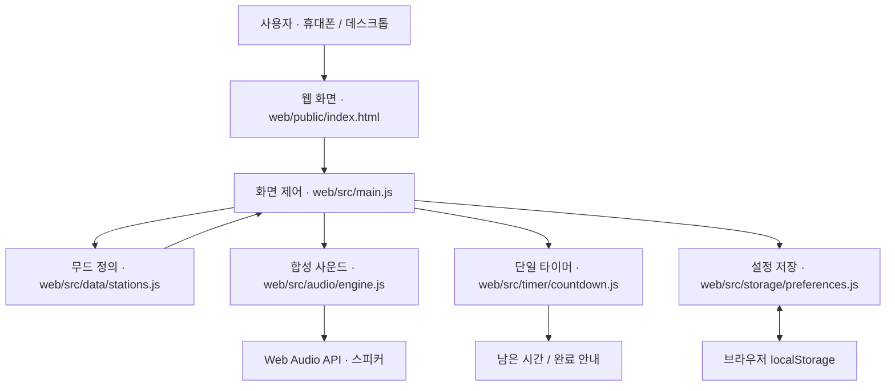
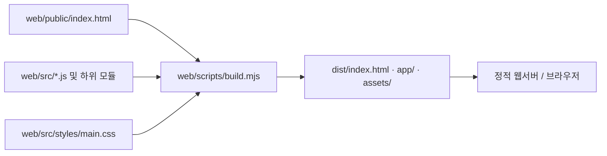

# 웹앱 구조

Kitchen Mood Radio는 화면, 소리, 시간, 사용자 설정을 브라우저 안에서 처리한다.

## 모듈 연결

## 소스 역할

| 파일 | 역할 |
| --- | --- |
| `web/public/index.html` | 버튼, 라디오, 타이머, 문구 영역 |
| `web/src/main.js` | 사용자 입력을 모듈에 전달하고 화면 갱신 |
| `web/src/data/stations.js` | 무드 이름, 화면 문구, 합성 음색 패턴 |
| `web/src/audio/engine.js` | 음 생성, 재생·정지, 볼륨, 무드 전환 |
| `web/src/timer/countdown.js` | 시작·일시정지·재개·초기화 및 남은 시간 |
| `web/src/storage/preferences.js` | 마지막으로 선택한 무드 읽기·저장 |
| `web/src/styles/main.css` | 세 가지 색상 테마와 반응형 화면 |
| `web/scripts/build.mjs` | 브라우저에서 실행할 파일을 `web/dist`로 복사 |

## 화면 갱신

무드를 바꾸면 화면 색상, 스테이션 제목, 한마디를 즉시 바꾼다. 재생 중에는 새로운 무드의 소리 패턴으로 전환한다. 재생 전에는 화면만 바뀐다.

타이머는 시간의 종료 시점을 저장하고 현재 시각과의 차이를 표시한다. 화면 갱신이 늦어져도 종료 시각은 유지한다.

## 저장되는 정보

선택한 무드 문자열 하나를 브라우저 로컬 저장소에 남긴다. 저장소를 사용할 수 없는 환경에서도 현재 페이지의 기능은 동작한다. 타이머 진행 상황과 배경음 재생 상태는 페이지를 새로 열 때 초기화된다.

## 빌드

